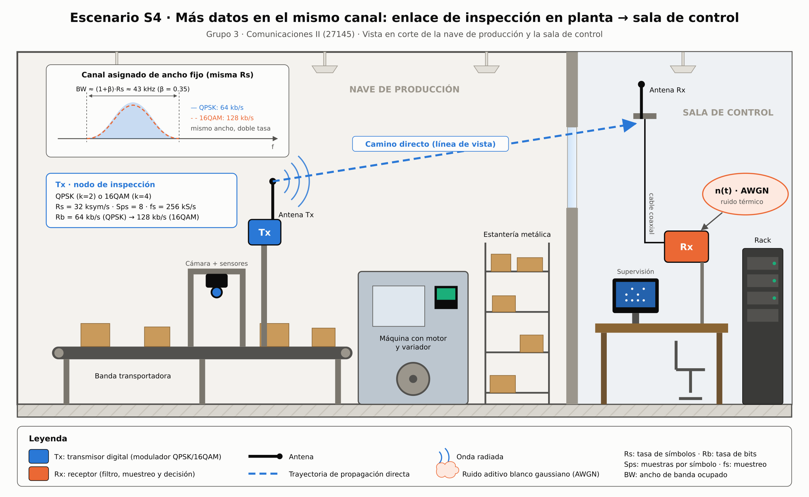
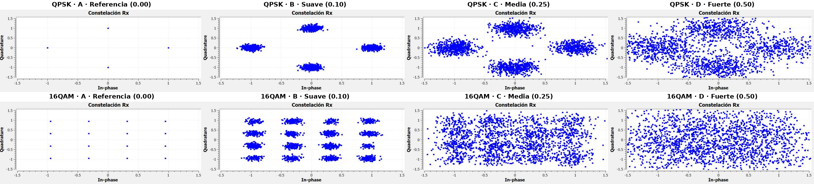
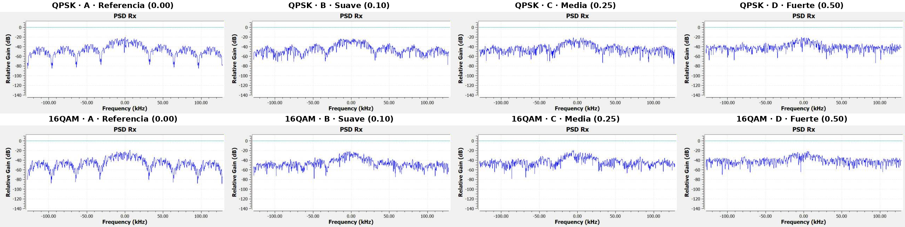
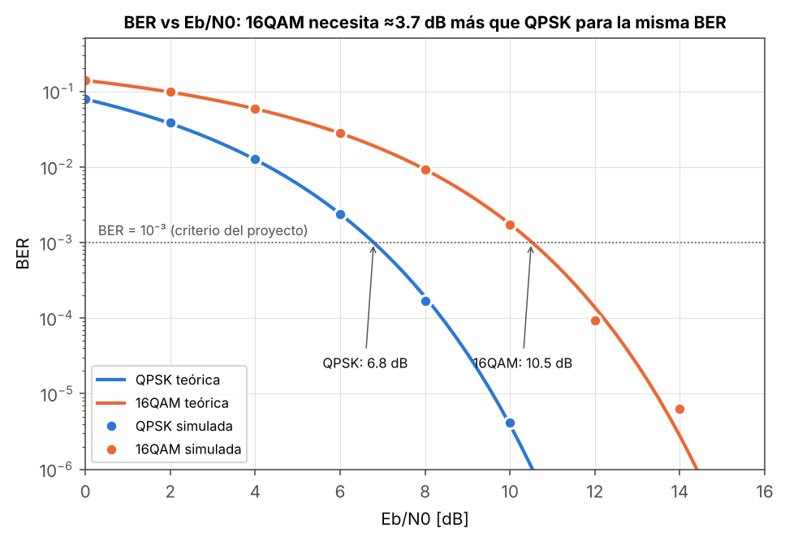

# Más datos en el mismo canal: QPSK vs 16QAM con igual tasa de símbolos

**Escenario S4 · Mayor tasa de datos con una tasa de símbolos similar**
Proyecto Integrador · Comunicaciones II (27145) · Universidad Industrial de Santander · 2026-2

>  **Blog del proyecto:** _[PENDIENTE: pegar aquí el enlace público al blog]_

>  **Video de socialización:** https://youtu.be/GtYRcSvRmO4

## Integrantes · Grupo 3

| Nombre | Código |
|---|---|
| Nicolas Alvarez Alvarez | 2192317 |
| Karoll Juliana Ruiz Martinez | 2224724 |
| Liliam Daniela Rodriguez Morales | 2192316 |

## Resumen

Una aplicación industrial necesita enviar más información sin salirse de un canal de ancho fijo. En lugar de subir la tasa de símbolos, este proyecto compara QPSK (2 bits/símbolo) y 16QAM (4 bits/símbolo) con la misma Rs = 32 ksym/s, Sps = 8 y fs = 256 kS/s en GNU Radio. Las dos ocupan el mismo ancho de banda, pero 16QAM duplica la tasa de bits, de 64 kb/s a 128 kb/s. El costo es la robustez: con energía promedio normalizada, la distancia mínima de 16QAM (0.63) es menos de la mitad de la de QPSK (1.41). Con el mismo ruido, 16QAM se degrada primero, y para BER = 10⁻³ necesita ≈ 3.7 dB más de Eb/N0. Después, el enlace 16QAM se llevó a hardware con dos HackRF One para medir su curva BER vs Eb/N0.

## Ficha técnica

| Elemento | Valor |
|---|---|
| Modulación principal | 16QAM (Gray, Es = 1) |
| Modulación de comparación | QPSK (Es = 1) |
| Rs | 32 000 sym/s (simulación) · 8 000 sym/s (HackRF, Fase 4) |
| Rb = Rs · log₂M | QPSK 64 kb/s · 16QAM 128 kb/s (simulación) · 16QAM 32 kb/s (HackRF) |
| Sps | 8 |
| fs = Rs · Sps | 256 kS/s (simulación) · 64 kS/s en banda base (HackRF, radio a 2 MS/s) |
| Pulso | Rectangular `h=[1]*Sps` (Fase 1) · RRC β = 0.35 (Guía 2) · RRC β = 0.5 (HackRF) |
| Ancho de banda | Lóbulo principal 2·Rs = 64 kHz (rect.) · (1+β)·Rs ≈ 43.2 kHz (RRC) |
| Perturbación | AWGN (Noise Source gaussiano complejo, `noise_amp`) |
| Variable del experimento | `noise_amp`: 0.00 / 0.10 / 0.25 / 0.50 |



## Archivos GRC y cómo ejecutarlos

| Archivo | Descripción |
|---|---|
| `grc/archivos_modificados/Grupo03_S4_QPSK_AWGN.grc` | **Principal (comparación).** Copia del GRC base con la tabla QPSK |
| `grc/archivos_modificados/Grupo03_S4_16QAM_AWGN.grc` | **Principal.** Copia del GRC base con la tabla 16QAM Gray normalizada (÷√10) |
| `grc/archivos_originales_o_referencia/` | GRC originales del curso, sin modificar (Fase 1, HackRF TX/RX y kit BER de la Fase 4) |

1. Abrir el `.grc` en GNU Radio Companion 3.10 (probado con 3.10.12).
2. Ejecutar (F6). En la ventana, mover el control **noise_amp** al valor de cada prueba (0, 0.10, 0.25, 0.50).
3. Capturar la PSD, la constelación y la envolvente compleja de cada prueba.

**Modificaciones respecto al original `Modulaciones_basadas_en_constelaciones_AWGN.grc`:**
- `tabla_de_verdad_constelacion`: de OOK `(0+0j, 1+0j)` a QPSK `(1, j, −j, −1)` o 16QAM Gray `(±1, ±3 ± j…)/√10`. La división por √10 deja la energía promedio en 1, para que las dos modulaciones se comparen con la misma potencia y el mismo ruido.
- `noise_amp`: valor inicial de 0.10 a 0.0 (prueba de referencia).
- QT GUI Constellation Sink: ejes fijos ±1.5 en lugar de autoescala, para que las capturas de las 4 pruebas sean comparables.
- `id` y `title` del flujograma renombrados, para no sobrescribir el `.py` generado por el original.
- `gui_hint` de los visores en cuadrícula (envolvente arriba, PSD y constelación abajo), para ver las tres gráficas en una sola ventana.

Las capturas reales de GNU Radio Companion 3.10 (radioconda, Windows) de las 4 pruebas están en `figures/capturas_gnuradio/`. Las figuras de análisis también se pueden reproducir con `scripts/sim_fase1.py`, que replica en Python la misma cadena del GRC: `python3 scripts/sim_fase1.py .`

## Tabla de pruebas (Fase 1–2, simulación)

Condiciones constantes: Rs = 32 ksym/s, Sps = 8, fs = 256 kS/s, pulso rectangular, Es = 1. Solo cambia `noise_amp`.
BER medida con un receptor ideal (filtro acoplado integrar-y-descargar + decisión por mínima distancia), con 400 000 bits (QPSK) y 800 000 bits (16QAM) por prueba.

| Prueba | noise_amp | Eb/N0 QPSK | BER QPSK | Eb/N0 16QAM | BER 16QAM | Observación |
|---|---|---|---|---|---|---|
| A · Referencia | 0.00 | ∞ | 0 | ∞ | 0 | Puntos ideales |
| B · Suave | 0.10 | 26.0 dB | 0 | 23.0 dB | 0 | Nubes pequeñas y separadas |
| C · Media | 0.25 | 18.1 dB | 0 | 15.1 dB | 0 (≈1.6·10⁻⁷ teórica) | 16QAM: las nubes se tocan |
| D · Fuerte | 0.50 | 12.0 dB | 0 (≈7.7·10⁻⁹ teórica) | 9.0 dB | **4.2·10⁻³** | 16QAM falla, QPSK resiste |

Datos completos: [`data/tablas_de_pruebas/tabla_pruebas_QPSK_vs_16QAM.csv`](data/tablas_de_pruebas/tabla_pruebas_QPSK_vs_16QAM.csv)

| Constelaciones (4 pruebas) | PSD (4 pruebas) |
|---|---|
|  |  |



## Fase 4 · Validación en hardware (HackRF One)

- `LAB_TX_16QAM_HackRF_MEJORADO.grc` / `LAB_RX_16QAM_HackRF_MEJORADO.grc`: 16QAM Gray, Rs = 8 ksym/s, Sps = 8, β = 0.5, fc = 960 MHz, radio a 2 MS/s con desplazamiento digital de 200 kHz.
- Resultado en clase (5 nov 2026, por antenas): BER ≈ 0.34 %, EVM ≈ 7.4 %, 81 % de tramas con CRC correcto. Evidencias en `figures/evidencias_laboratorio/`.
- Curva BER vs Eb/N0 con el kit `e_EbN0_Sweep` + `e_BER_Curve`: _[PENDIENTE: `data/curva_BER.csv`]_

## Conclusión principal

Con la misma tasa de símbolos, 16QAM duplica la tasa de bits sin ocupar más ancho de banda (las PSD de QPSK y 16QAM se superponen). La capacidad extra no es gratis: con el mismo nivel de ruido, la constelación 16QAM se emborrona primero, porque sus puntos están 2.2 veces más cerca. Para llegar a BER = 10⁻³ necesita ≈ 10.5 dB de Eb/N0, frente a ≈ 6.8 dB de QPSK. 16QAM conviene cuando el enlace tiene buena relación señal a ruido; si el canal es ruidoso, QPSK es la opción más segura.

## Estructura del repositorio

```
ComunicacionesII_Grupo03/
├── README.md
├── grc/  (archivos_originales_o_referencia/, archivos_modificados/)
├── figures/  (escenario/, psd/, constelacion_o_fsk/, senal_temporal/, diagramas_tecnicos/, evidencias_laboratorio/)
├── data/tablas_de_pruebas/
├── docs/  (informe_final.pdf + .tex, ficha_decision_tecnica.pdf, bitacora.md)
├── scripts/  (simulación en Python que reproduce las figuras)
└── referencias/fuentes_y_enlaces.md
```

## Uso de IA

Se usó un asistente de IA (Claude) para organizar el repositorio, generar las figuras con Python y dibujar las ilustraciones del escenario. Todos los parámetros, cálculos y resultados fueron revisados por el equipo y verificados contra los GRC y la teoría (ver `docs/bitacora.md`).

_Última actualización: 9 de noviembre de 2026_
